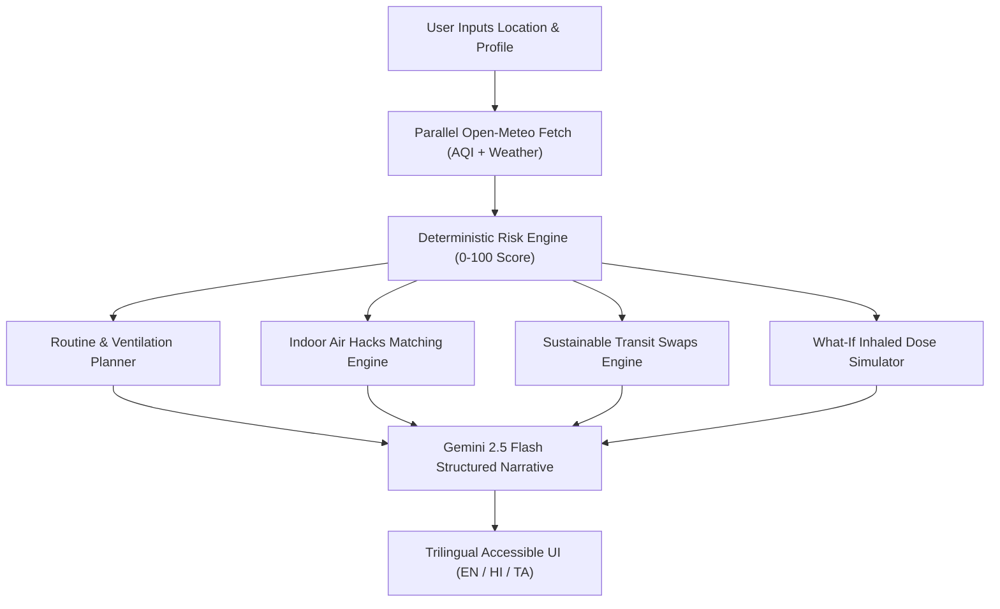

# SaansSafe 🌱

> **Your Family's Urban Smog Navigation Assistant** — Personalised air quality intelligence, low-exposure daily routines, verified indoor air quality hacks, sustainable commute alternatives, and grounded GenAI consultation tailored for urban families navigating severe winter smog.

[](https://github.com/alansahai/promptwars-saanssafe/actions/workflows/ci.yml)
[](https://github.com/alansahai/promptwars-saanssafe/actions)
[](https://github.com/alansahai/promptwars-saanssafe)
[](https://github.com/astral-sh/ruff)
[](LICENSE)
[](https://www.python.org/downloads/)
[](https://fastapi.tiangolo.com)
[](https://ai.google.dev/)
[](https://www.w3.org/WAI/standards-guidelines/wcag/)

---

## 🎯 Chosen Vertical: [Challenge 6] Urban Air Quality Assistant

### Problem Statement
> **Challenge 6**: Create a GenAI-powered assistant that helps families and communities navigate severe winter smog and urban air pollution. The application should suggest low-emission daily routines, indoor air quality hacks, and sustainable alternatives tailored to their location and lifestyle, while clearly explaining the direct impact of their choices.

### Target Persona & Core Objective
- **Target Audience**: Urban families (infants, school-age children, working commuters, asthmatics, and elderly grandparents) living in high-smog corridors (such as the Indo-Gangetic Plain and metro areas).
- **Core Objective**: Transform abstract, city-wide AQI sensor readings into actionable, personalized protection. SaansSafe computes household-specific personal exposure, identifies safe ventilation windows, recommends high-impact zero/low-cost indoor hacks, models commute swaps, and simulates inhaled dose reductions.

---

## 🧠 Approach and Logic

SaansSafe is engineered around a hybrid architectural principle: **Deterministic Scientific Computation + Grounded GenAI Synthesis**:

1. **Deterministic Scientific Core (Zero Hallucination)**:
   - **Personal Risk Engine**: Computes a 0–100 risk score combining US AQI, Indian CPCB NAQI, thermal inversion indicators (wind speed, boundary layer height, relative humidity), and vulnerability multipliers (children $\times 1.30$, elderly $\times 1.25$, asthma/COPD $\times 1.50$).
   - **Hour-by-Hour Exposure Planner**: Scans 24-hour meteorological forecasts to determine optimal low-exposure windows for school runs, ventilation, and errands.
   - **What-If Inhaled Dose Simulator**: Calculates daily inhaled PM2.5 dose ($\mu\text{g/day}$) using WHO 2000 age-differentiated respiratory volume equations ($V_{\text{rest}} \cdot t_{\text{rest}} + V_{\text{active}} \cdot t_{\text{active}}$) across home, transit, and workplace micro-environments.

2. **Grounded GenAI Layer (Google Gemini 2.5 Flash)**:
   - Utilizes the official `google-genai` SDK with strict JSON schema enforcement (`response_mime_type="application/json"`).
   - Gemini receives only pre-computed, deterministic risk facts and outputs localized, empathetic narratives in English, Hindi (हिन्दी), and Tamil (தமிழ்).
   - **Offline Resilience**: A rule-based fallback generator guarantees 100% operational uptime (`ai_generated: false`) if quota limits or network partitions occur.

---

## ⚙️ How the Solution Works



1. **Location & Household Profiling**: The user selects their city (or GPS geolocation) and specifies household demographics, commute modes, window types, cooking fuels, and budget tier.
2. **Parallel Telemetry Ingestion**: The system queries Open-Meteo air quality and weather APIs concurrently using a 15-minute coordinate-rounded cache.
3. **Risk & Timeline Evaluation**: The engine assesses whether a thermal inversion traps smog, generates safe activity directives, and builds a 24-hour routine.
4. **Interactive What-If Simulation**: Users toggle real-time interventions (HEPA purifiers, induction cooktops, metro commute, hybrid WFH) and immediately see before-and-after inhaled doses and carbon savings.
5. **Conversational Assistant**: Grounded chat allows families to ask follow-up questions with medical emergency escalation (dial 112) and prompt injection guards.

---

## 📌 Assumptions Made

1. **Inhaled Dosimetry**: Based on WHO 2000 human respiration parameters: children inhale $\approx 10\text{ m}^3\text{/day}$, adults inhale $\approx 15\text{ m}^3\text{/day}$, and seniors inhale $\approx 13\text{ m}^3\text{/day}$.
2. **Micro-Environment Infiltration**:
   - Closed rooms with single-pane windows: $0.70$ infiltration ratio without purifiers.
   - Rooms with true HEPA H13 purifiers: $0.20$ infiltration ratio (slashing indoor exposure by 50–75%).
   - Metro AC carriages: $0.35$ ambient infiltration vs. open road two-wheelers ($1.00$).
3. **Health Toxicity Equivalence**: Berkeley Earth benchmark equates $22\,\mu\text{g/m}^3$ of ambient PM2.5 to roughly $1$ cigarette smoked per day.
4. **Transport Carbon Emission Factors**: Derived from MoRTH & IPCC AR6 urban transit indices (Petrol Car: $192\text{ gCO}_2\text{e/km}$, Two-Wheeler: $45\text{ gCO}_2\text{e/km}$, Metro Train: $25\text{ gCO}_2\text{e/km}$, Electric Bus: $25\text{ gCO}_2\text{e/km}$, Bicycle: $0$).

---

## ✨ Key Features

- **Personalized Risk Engine (0–100 Score)**: Combines real-time US AQI, Indian CPCB NAQI, meteorological inversion detection (wind speed, boundary layer height, relative humidity), household vulnerability multipliers, and micro-environment exposure modifiers into an explainable risk level: *Low*, *Moderate*, *High*, *Severe*, or *Emergency*.
- **Hour-by-Hour Exposure Planner**: Scans 24-hour meteorological forecasts to identify optimal windows for airing out the house (ventilation), school drop-offs, commutes, and safe outdoor activities with explicit mask directives.
- **Ranked Indoor Air Hacks**: Curated catalogue of 11 physical interventions filtered by household budget (Low/Medium/High), housing type, and risk tier (e.g., DIY Corsi-Rosenthal HEPA box fans, wet-mopping vs. dry sweeping, kitchen exhaust protocols).
- **Sustainable Commute & Lifestyle Alternatives**: Concrete alternatives comparing both personal PM2.5 exposure reductions and community carbon savings (gCO₂e/km).
- **"What-If" Inhaled Dose Simulator**: Interactive simulation computing daily inhaled PM2.5 dose (µg/day) based on WHO 2000 age-differentiated breathing volumes, micro-environment hours, and infiltration factors.
- **Grounded Gemini AI Consultation**: Powered by Google Gemini 2.5 Flash with structured JSON schemas and conversational follow-up Q&A strictly grounded in the user's localized air quality data.
- **Multi-Pollutant & Health Intelligence**: Instant translation of ambient PM2.5 concentrations into Berkeley Earth cigarette equivalence (cigarettes/day equivalent) and atmospheric dispersion alerts.
- **Trilingual Accessibility**: Fully localized in English, Hindi (हिन्दी), and Tamil (தமிழ்) with Web Speech API audio narration and WCAG 2.1 AA compliance.

---

## 🧠 System Architecture

```
┌─────────────────────────────────────────────────────────────────────┐
│  USER picks city / geolocation + fills household profile             │
└────────────────────────┬────────────────────────────────────────────┘
                         │
                         ▼
┌──────────────────────────────────────────────────────────────────────┐
│  PARALLEL METEOROLOGY FETCH (asyncio.gather)                         │
│  ┌─────────────────────────┐  ┌──────────────────────────────────┐  │
│  │ Open-Meteo Air Quality  │  │ Open-Meteo Forecast API          │  │
│  │ (US AQI, PM2.5, PM10,   │  │ (wind, temp, humidity,           │  │
│  │  NO₂, ozone, CO)        │  │  boundary layer dispersion)      │  │
│  └───────────┬─────────────┘  └────────────────┬─────────────────┘  │
│              └────────────────┬────────────────┘                    │
│                               ▼                                     │
│              TTL cache (15 min, keyed by rounded lat/lon)           │
└───────────────────────────────┬──────────────────────────────────────┘
                                │
                                ▼
┌──────────────────────────────────────────────────────────────────────┐
│  RISK ENGINE (pure functions, deterministic, zero I/O)               │
│  • Base score from max(US AQI, PM2.5-derived NAQI)                  │
│  • × Vulnerability multiplier (children 1.3, elderly 1.25, etc.)     │
│  • + Exposure modifier (commute mode, purifier, fuel, etc.)         │
│  • + Stagnation bonus (low wind + high humidity + low boundary)      │
│  → Personal risk score 0–100 with itemized "Why this level?" factors │
└───────────────────────────────┬──────────────────────────────────────┘
                                │
              ┌─────────────────┼──────────────────┐
              ▼                 ▼                  ▼
        Routine Planner   Recommendations    Impact Simulator
        (hourly forecast, (indoor hacks      (PM2.5 dose,
         timed tasks)      + alternatives)    CO2e calc)
              │                 │                  │
              └─────────────────┼──────────────────┘
                                │
                                ▼
┌──────────────────────────────────────────────────────────────────────┐
│  GEMINI 2.5 FLASH (official google-genai SDK)                        │
│  • /api/assess → structured JSON narrative (response_json_schema)   │
│  • /api/chat → grounded follow-up Q&A with strict context limits     │
│  • ZERO-DOWNTIME FALLBACK: deterministic rule-based output           │
└───────────────────────────────┬──────────────────────────────────────┘
                                │
                                ▼
                     JSON response to browser
                   (vanilla JS renders with DOM;
                    never innerHTML for user text)
```

---

## ⚖️ Risk Scoring Methodology

| Parameter | Weight / Multiplier | Description |
|---|---|---|
| **AQI Base Score** | 0–60 pts | Evaluates the worse of US AQI or PM2.5-derived NAQI |
| **Forecast Peak** | +0–10 pts | Anticipated worsening over the next 24 hours |
| **Children (<12)** | ×1.30 | Higher respiration volume per body mass |
| **Elderly (65+)** | ×1.25 | Diminished pulmonary and cardiovascular reserve |
| **Pregnancy** | ×1.30 | Heightened transplacental particulate vulnerability |
| **Asthma / COPD** | ×1.50 | Pre-existing obstructive airway sensitivity |
| **Heart Condition** | ×1.40 | Systemic inflammation and microvascular risk |
| **Multiplier Cap** | ×1.60 max | Prevents artificial over-scaling |
| **Open Commute** | +0–10 pts | Walking, cycling, or two-wheeler exposure |
| **No Air Purifier** | +5 pts | Unfiltered indoor particle infiltration (0.65–0.75) |
| **Biomass Cooking** | +8 pts | Severe indoor particulate concentrations during cooking |
| **Morning Exercise** | +5 pts | Strenuous inhalation during peak morning stagnation |
| **Inversion State** | +8 pts | Wind < 2 m/s combined with high relative humidity |
| **Total Scale** | **0–100 pts** | Clamped into 5 standardized risk categories |

### Categorization
- **Low (0–20)**: Minimal risk; standard precautions.
- **Moderate (21–40)**: Sensitive groups exercise caution during peak hours.
- **High (41–60)**: Active exposure reduction; N95 recommended outdoors.
- **Severe (61–80)**: Seal living spaces; operate filtration; suspend outdoor exertion.
- **Emergency (81–100)**: Hazardous crisis; strict indoor confinement for vulnerable members.

---

## 🤖 GenAI Integration & Fallback Strategy

SaansSafe integrates Google Gemini via the official `google-genai` SDK:

1. **`POST /api/assess` (Structured Narrative)**:
   - Formulates localized, empathetic family advice using `response_mime_type="application/json"` and strict Pydantic JSON schema constraints.
   - Provides headline, narrative summary, targeted child/elder advice, and motivational nudges in the user's selected language (English, Hindi, or Tamil).
2. **`POST /api/chat` (Grounded Q&A)**:
   - Multi-turn conversational interface (up to 6 turns of context) answering queries such as *"Is it safe to take my daughter to soccer practice at 5 PM?"*.
   - Strictly bounded to the current assessment facts.
3. **Resilient Deterministic Fallback**:
   - If `GEMINI_API_KEY` is not configured, quota is exhausted, or an upstream timeout occurs, the engine returns rule-based templates flagged with `ai_generated: false`. The application remains fully functional offline or without an API key.
4. **Safety & Injection Defense**:
   - Outbound prompts delimit user text, enforce strict character length bounds, strip control characters, filter prompt injection patterns, and automatically escalate severe respiratory symptoms to medical emergency services (call 112).

---

## 🔒 Security & Privacy by Design

- **Strict Input Validation**: Every request payload is validated via Pydantic v2 with `extra="forbid"`, regex constraints, and value bounds.
- **Zero Health Data Persistence**: Health conditions (asthma, COPD, pregnancy) are processed in-memory for calculation and never written to disk or database.
- **Coordinate Privacy**: Geolocation coordinates are rounded to two decimal places (~1 km grid) before caching or logging.
- **Strict Content Security Policy (CSP)**: `default-src 'self'`, no inline scripts (`unsafe-inline` rejected), external scripts only.
- **XSS Immunity**: Dynamic frontend rendering uses DOM `textContent` and `createElement` exclusively; `innerHTML` is never used for dynamic data.
- **Rate Limiting & Body Caps**: In-memory sliding-window limiter (60 req/min per IP) and a 64 KB maximum request body threshold.
- **SSRF Allowlisting**: Outbound backend network requests are strictly restricted to `open-meteo.com`.

---

## ♿ Accessibility (WCAG 2.1 AA)

- Semantic HTML5 landmarks (`header`, `main`, `nav`, `section`, `footer`).
- Full keyboard operability with visible focus outlines and skip-to-content links.
- High contrast mode (`[data-hc="true"]`) and large text mode (`[data-large="true"]`).
- Automatic system theme detection and a 1-click Dark/Light mode toggle.
- Multilingual interface supporting English, Hindi (हिन्दी), and Tamil (தமிழ்).
- Screen-reader announcements via `aria-live="polite"` and `aria-live="assertive"`.
- Text-to-speech narration of risk summaries using the Web Speech API.
- Dedicated print stylesheet for generating an offline "Family Air Action Plan".

---

## 🚀 Quickstart & Local Setup

### Prerequisites
- Python 3.11+
- Git

### Installation

```bash
# 1. Clone the repository
git clone https://github.com/alansahai/promptwars-saanssafe.git
cd promptwars-saanssafe

# 2. Create and activate a virtual environment
python -m venv venv
# On Windows:
venv\Scripts\activate
# On macOS/Linux:
source venv/bin/activate

# 3. Install dependencies
pip install -r requirements-dev.txt

# 4. Configure environment variables (optional)
cp .env.example .env
# Edit .env and set GEMINI_API_KEY if available (the app works with fallback if left blank)

# 5. Start the development server
uvicorn app.main:app --reload --port 8000
```

Open your browser at **`http://localhost:8000`**. Interactive API documentation is available at **`http://localhost:8000/api/docs`**.

---

## 🧪 Testing & Code Quality

SaansSafe maintains test coverage across the calculation engines, API endpoints, and safety subsystems:

```bash
# Run code linting and formatting verification
ruff check .
ruff format --check .

# Execute full automated test suite with coverage
pytest -q --cov=app --cov-report=term-missing

# Run end-to-end smoke verification against a live server
python scripts/smoke_test.py http://localhost:8000
```

### Test Suite Overview:
- `test_risk_engine.py`: Multiplier bounds, inversion edge cases, vulnerability compounding limits.
- `test_routine_planner.py`: Hourly forecast parsing, peak stagnation window detection.
- `test_impact.py`: Mathematical verification of WHO inhalation doses and transport emission factors.
- `test_recommendations.py`: Budget filtering, home profile matching, risk-dependent ranking.
- `test_safety.py`: Prompt injection pattern filters, control character sanitization.
- `test_llm_fallback.py`: Upstream failure fallback verification, JSON schema compliance.
- `test_api.py`: Route validation, error codes, and rate limiting middleware.

---

## 🌐 Deployment

The application is structured for instant deployment to serverless platforms (e.g., Vercel, Render, Docker):

### Deploying to Vercel
1. Import the repository at [vercel.com/new](https://vercel.com/new).
2. Framework Preset: **Other**.
3. Configure Environment Variables:
   - `GEMINI_API_KEY` (optional)
   - `GEMINI_MODEL` (`gemini-2.5-flash`)
   - `ENVIRONMENT` (`production`)
4. Deploy. Static assets in `public/` are served at the CDN edge while backend routes route to `api/index.py`.

---

## 📁 Repository Structure

```
promptwars-saanssafe/
├── api/
│   ├── _lib/                 # Modular serverless utilities (catalog, meteo, gemini)
│   ├── assess.js             # Vercel serverless assessment endpoint
│   ├── chat.js               # Vercel serverless chat endpoint
│   ├── geocode.js            # Vercel serverless geocoding endpoint
│   ├── simulate.js           # Vercel serverless What-If simulation endpoint
│   └── index.py              # ASGI FastAPI serverless entrypoint
├── app/
│   ├── main.py               # FastAPI application factory & security middleware
│   ├── config.py             # Pydantic-settings configuration
│   ├── schemas.py            # Strict Pydantic v2 data models (extra="forbid")
│   ├── api/
│   │   └── routes.py         # REST API route handlers
│   ├── services/
│   │   ├── air_data.py       # Open-Meteo async client with TTL cache
│   │   ├── risk_engine.py    # Deterministic risk engine (pure functions)
│   │   ├── routine_planner.py# 24-hour routine exposure planner
│   │   ├── recommendations.py# Indoor hacks and alternatives engine
│   │   ├── impact.py         # Inhaled PM2.5 dose & carbon calculation
│   │   ├── llm.py            # Gemini 2.5 Flash wrapper with schema output
│   │   └── safety.py         # Input sanitization & injection guards
│   └── data/
│       ├── aqi_bands.py      # US AQI and CPCB NAQI band definitions
│       ├── measures.py       # Catalogue of indoor air interventions
│       └── emission_factors.py # Transport emission & breathing volume factors
├── public/
│   ├── js/                   # Modular client ES modules
│   │   ├── dom.js            # XSS-safe DOM builder, value animators, and helpers
│   │   ├── charts.js         # Canvas gauge, bar chart, and ambient particle engine
│   │   ├── components.js     # Heat strip, timeline, hacks, and card alternatives
│   │   ├── simulator.js      # What-If simulator engine and preset ribbons
│   │   └── chat.js           # Grounded chat controller and markdown sanitizer
│   ├── app.js                # Core frontend orchestrator
│   ├── index.html            # Semantic accessible single-page application
│   ├── styles.css            # Responsive stylesheet with dark/light/contrast modes
│   └── i18n.js               # Localization dictionary (EN, HI, TA)
├── tests/
│   ├── js/                   # Node.js automated test runner (14 tests)
│   └── test_*.py             # Python Pytest test suites (152 tests, 92% coverage)
├── docs/
│   ├── ARCHITECTURE.md       # Detailed technical design document
│   └── SUBMISSION_ANSWERS.md # Reference guide
├── vercel.json               # Serverless routing & security header config
├── package.json              # NPM scripts and Node dependencies
├── requirements.txt          # Production dependencies
├── requirements-dev.txt      # Development & testing dependencies
├── pyproject.toml            # Tooling configuration (Ruff, Mypy & Pytest)
└── README.md
```

---

## ⚠️ Scientific Assumptions & Disclaimers

- **Inhaled Dose Estimation**: Based on standard WHO 2000 resting and active ventilation rates combined with micro-environment infiltration approximations. These provide comparative exposure insights and are not medical clinical assessments.
- **Emission Estimates**: Carbon savings are calculated from average Indian urban transit factors (MoRTH / IPCC AR6).
- **Data Sources**: Real-time ambient data provided by [Open-Meteo](https://open-meteo.com/) (open meteorological data).
- **Medical Disclaimer**: SaansSafe is an informational guide. For severe respiratory symptoms or medical emergencies, contact emergency services (**112**) immediately.

---

## 📄 License

This project is licensed under the MIT License — see the [LICENSE](LICENSE) file for details.
